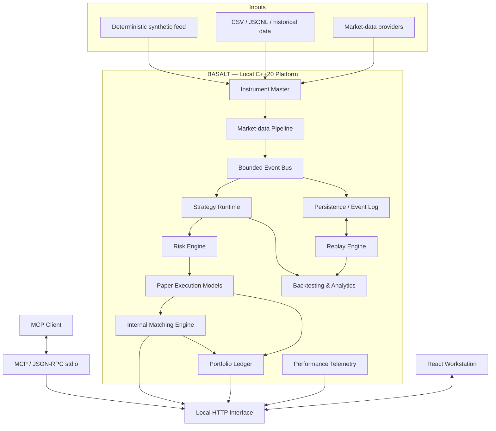

# BASALT

### A local-first market simulation and quantitative trading research platform.

BASALT is a C++20 systems project for exploring how electronic markets work — from order matching and market-data processing to strategy execution, risk management, paper trading, deterministic replay and performance analysis.

It combines a deterministic exchange simulator with a growing research infrastructure. The goal is to make the mechanics of trading systems observable, testable and reproducible, rather than treat trading as a black box.

**BASALT is simulation-first. It does not place live brokerage orders.**

---

## What it does

BASALT is built around several connected areas of market infrastructure:

| Area | Capabilities |
|---|---|
| **Exchange simulation** | Price-time priority, limit and market orders, partial fills, cancellation, multi-instrument books and advanced order types |
| **Market data** | Instrument master, canonical events, feed-quality validation, synthetic data and local historical replay |
| **Paper execution** | Quote-based, bar-based, order-book replay and internal CLOB execution models |
| **Risk management** | Pre-trade risk checks, exposure reservations, audit records and scoped kill switches |
| **Strategy runtime** | Deterministic strategy lifecycle, incremental indicators and six built-in strategies |
| **Backtesting** | Chronological execution, train/validation/test separation, reproducibility manifests and performance analytics |
| **Persistence and replay** | Append-only event logs, checkpoints, dataset hashing and deterministic recovery |
| **Performance engineering** | Latency telemetry, twelve benchmark workloads and comparisons between map/list, vector and pooled-arena order books |
| **MCP interface** | Local JSON-RPC tools for inspecting state and running bounded simulations |

The components are implemented as C++ libraries with explicit domain boundaries. The browser workstation and MCP interface provide ways to inspect and interact with the system.

## Architecture

BASALT follows a local-process, modular architecture. It does not depend on a distributed microservice stack.



The diagram represents the platform architecture. It does not imply that every external feed, research module and application read model is already connected into one end-to-end runtime.

### Core engineering principles

- **Deterministic state transitions:** matching and replay should produce reproducible results from the same ordered inputs.
- **Integer-based financial arithmetic:** authoritative price, cash, fee and P&L calculations use fixed-point integer representations rather than floating-point money.
- **Explicit event ordering:** events carry sequence and timestamp information; feed gaps, duplicates and out-of-order data are treated as observable conditions.
- **Separation of liquidity:** external market observations are not internal resting orders. Only an explicitly selected paper execution model can translate observations into simulated fills.
- **Risk before execution:** strategies produce order intents. The risk engine decides whether those intents can proceed to paper execution.
- **Auditable results:** fills, fees, ledger changes, replay inputs and benchmark conditions should be inspectable.
- **Bounded resources:** queues, payloads, replay steps and MCP operations have explicit limits.

---

## Main components

### 1. Matching engine

The original core of BASALT is a deterministic C++ order-book and matching engine.

The standard order book uses:

- `std::map` for ordered bid and ask price levels.
- `std::list` for FIFO order queues at each price level.
- `std::unordered_map` for order-ID lookup and cancellation.

It supports price-time priority, maker-price execution, partial fills, full fills and cancellation.

The multi-instrument engine extends this with:

- Instrument-isolated order books.
- `LIMIT` and `MARKET` orders.
- `IOC`, `FOK` and `POST_ONLY`.
- `STOP_MARKET` and `STOP_LIMIT`.
- Order amendments with defined priority behavior.
- Account/participant self-trade prevention policies.

A single instrument's book is mutated in an explicitly ordered manner. Different instruments are isolated from one another.

### 2. Market-data infrastructure

Market data enters through provider-neutral interfaces and is normalized into canonical events.

The pipeline handles:

- Instrument resolution and provider mappings.
- Price, tick and lot validation.
- Duplicate and out-of-order events.
- Sequence gaps and reconnect generations.
- Stale data and clock-skew conditions.
- Bounded event distribution and queue pressure.

Available offline inputs include a deterministic synthetic provider and bounded CSV/JSON Lines replay.

Upstox v3 and FYERS adapters currently remain diagnostic-only. They are not active market-data connections, do not read credential values and do not expose order-placement capabilities.

### 3. Paper execution and risk

BASALT includes four offline execution models:

| Model | Execution basis |
|---|---|
| Conservative quote-based | External bid/ask observations, adverse slippage and visible quantity |
| Bar-based approximation | Subsequent-bar execution with configured costs and participation limits |
| Order-book replay | Recorded depth consumed at simulated arrival time |
| Internal CLOB | Orders matched against BASALT's own simulated liquidity |

Paper fills retain execution provenance, reference data, model version, latency assumptions, slippage and fee information.

The risk engine includes sixteen configurable pre-trade checks covering order size, notional, position limits, gross and net exposure, concentration, losses, drawdown, order rate, data quality and kill-switch state.

The portfolio ledger tracks cash, positions, fees and realized/unrealized P&L. It supports partial fills, short-position transitions, restart recovery and reconciliation.

**Fee schedules must be explicitly configured.** The default state is `NO_FEES_CONFIGURED`; BASALT does not assume that its example fee parameters represent current exchange, broker or statutory charges.

### 4. Strategy runtime

Strategies receive immutable market events and portfolio/risk context. They can produce `OrderIntent` values, but cannot directly mutate the order book or portfolio ledger.

The runtime enforces lifecycle transitions, warm-up periods, data-quality requirements and exception isolation.

Six deterministic built-in strategies are included:

1. SMA crossover.
2. RSI mean reversion.
3. Bollinger breakout/reversion.
4. Intraday VWAP reversion.
5. Momentum breakout with volume confirmation.
6. Top-five order-book imbalance.

Incremental indicators include SMA, EMA, Wilder RSI, Bollinger bands, session VWAP and order-book imbalance.

These are research implementations, not claims of profitability. Their outputs still pass through the risk engine and a selected paper execution model.

### 5. Backtesting and replay

The backtesting engine is designed around chronological correctness.

A signal generated from a completed bar cannot execute at that same bar's close. It becomes eligible no earlier than a subsequent bar, with configured execution costs and participation constraints.

Backtests include:

- Train, validation and held-out test ranges.
- Embargo and split validation.
- Dataset and configuration hashes.
- Strategy and build metadata.
- Execution, fee and risk assumptions.
- Signal, order, fill, cash and position journals.
- Deterministic result hashes.
- Eighteen analytics metrics.

Replay supports play, pause, single-step, seek and bounded speed multipliers. Checkpoints are validated before restoration.

Each backtest currently simulates one instrument per run. Missing survivorship-safe history, corporate-action information or licensing metadata must be disclosed rather than silently assumed.

### 6. Persistence

The persistence layer uses:

- An append-only `.blog` event log.
- Length- and version-framed records.
- CRC checksums and strictly increasing event sequences.
- Valid-prefix recovery and damaged-tail quarantine.
- Checksummed checkpoints.
- Deterministic checkpoint-plus-log replay.
- Historical CSV import/export with dataset hashes and provenance.

The configured Windows/Clang environment did not provide SQLite. The implementation therefore uses the roadmap's deterministic transactional file-store fallback. The SQLite schema in `docs/DATA_MODEL.md` remains a logical target, not a claim that SQLite is the active persistence backend.

### 7. Performance engineering

BASALT includes twelve deterministic workloads covering:

- Balanced, buy-heavy and sell-heavy flow.
- Aggressive matching.
- Cancellation-heavy activity.
- Concentrated and widely distributed price levels.
- Bursty arrivals.
- High active-order counts.
- Fifty-instrument dispatch.
- Market-data bursts.
- Slow-consumer backpressure.

The benchmark compares three order-book implementations:

- Standard map/list book.
- Sorted vector baseline.
- Pooled-arena book.

Measurements include throughput, latency percentiles, queue high-water marks, accepted and dropped events, and pool utilization.

Benchmark parity checks compare logical outcomes, including trades, cancellations and final book snapshots.

Performance numbers are workload- and machine-dependent. The recorded measurements are single-host results, not production latency guarantees. See [docs/PERFORMANCE.md](docs/PERFORMANCE.md) for methodology and raw output.

### 8. MCP interface

BASALT exposes a local Model Context Protocol server over newline-delimited JSON-RPC 2.0 on stdio.

It provides fourteen bounded tools:

- **Nine inspection tools** for health, market watch, instrument snapshots, order books, trades, paper positions, portfolio summaries, strategy status and feed health.
- **Five simulation tools** for backtesting, replay, allowlisted test execution, benchmarks and kill-switch activation.

The interface uses closed schemas, input bounds, rate limits, request idempotency and redacted audit logs.

It does not expose shell execution, arbitrary file access, environment dumps, credentials or live brokerage orders.

---

## Technology stack

| Layer | Technologies |
|---|---|
| Core and domain libraries | C++20, STL |
| Build system | CMake |
| HTTP server | cpp-httplib |
| JSON | nlohmann/json |
| Unit testing | GoogleTest |
| Workstation | React, TypeScript, Vite |
| UI state | Zustand |
| Styling | Tailwind CSS |
| Charts | Lightweight Charts |
| AI/tool interface | MCP, JSON-RPC 2.0 over stdio |
| Persistence | Deterministic file store, append-only `.blog` event log |

The C++ core is separated from HTTP, JSON and frontend concerns through application and adapter boundaries.

---

## Getting started

### Requirements

- Windows x64.
- Visual Studio 2022 or later, Clang 15+ or GCC 12+.
- CMake 3.20+.
- Ninja, or a Visual Studio CMake generator.
- Node.js 22.12+ and npm for the React workstation.
- Internet access during the first CMake configure so pinned dependencies can be downloaded through `FetchContent`.

### 1. Clone the repository

```powershell
git clone https://github.com/ShreyasLoL/Basalt.git
cd Basalt
```

### 2. Build the workstation

```powershell
cd frontend
npm ci
npm run typecheck
npm test
npm run build
cd ..
```

The production bundle is generated under `web/app/`. The C++ server serves this bundle when available and retains the static `web/index.html` fallback.

### 3. Configure and build the C++ project

With Ninja:

```powershell
cmake -S . -B build -G Ninja -DCMAKE_BUILD_TYPE=Release
cmake --build build --parallel
```

Or with Visual Studio 2022:

```powershell
cmake -S . -B build -G "Visual Studio 17 2022" -A x64
cmake --build build --config Release --parallel
```

The first configure downloads the pinned GoogleTest, cpp-httplib and nlohmann/json dependencies.

### 4. Run the tests

For Ninja:

```powershell
ctest --test-dir build --output-on-failure
```

For the Visual Studio generator:

```powershell
ctest --test-dir build -C Release --output-on-failure
```

### 5. Start BASALT

For a Ninja Release build:

```powershell
.\build\basalt_server.exe --port 8080
```

Open:

```text
http://127.0.0.1:8080
```

The server defaults to loopback operation. Keep it local; do not expose the server to a public network without a separately reviewed authentication and deployment model.

### 6. Run the benchmark suite

```powershell
.\build\basalt_bench.exe --orders 10000
```

Run a specific workload:

```powershell
.\build\basalt_bench.exe --orders 10000 --profile CANCEL_HEAVY
```

The benchmark CLI supports profiles for different order-flow and market-data conditions. Refer to [docs/PERFORMANCE.md](docs/PERFORMANCE.md) for the full workload list and interpretation.

For Visual Studio builds, executables are under `build/Release/`.

### 7. Start the MCP server

```powershell
.\build\basalt_server.exe --mcp-stdio
```

Launch this mode through an MCP client that manages stdio servers. See [docs/MCP.md](docs/MCP.md) for tool definitions, limits and protocol behavior.

---

## Verification

The repository's current `PROGRESS.md` records the following Phase 10 verification:

| Check | Recorded result |
|---|---:|
| C++ Release build | Passed |
| CTest suite | 123 / 123 |
| Frontend typecheck | Passed |
| Frontend Vitest suite | 7 / 7 |
| Frontend production build | Passed |
| MCP stdio lifecycle smoke test | Passed |
| Loopback HTTP smoke test | Passed |
| Compiler warnings under strict project flags | None reported |

The Phase 10 test count is cumulative across the matching engine, common utilities, market data, persistence, trading, strategy, backtesting, multi-instrument matching, telemetry and MCP modules.

These are the repository's recorded results. Re-run the build and tests in your own environment before relying on them.

---

## Important boundaries

BASALT is a research and simulation platform. It is not a production exchange gateway or a live trading system.

Current limitations and boundaries:

- No live brokerage order placement is implemented.
- Upstox and FYERS adapters are diagnostic-only, not active market-data connections.
- Provider-backed market data, paper-ledger and strategy-runtime read models are not all connected to the MCP process; unavailable data is reported as unavailable rather than fabricated.
- Each MCP process owns its own local simulation facade; it does not control another running BASALT process.
- The active persistence implementation is a deterministic file-store fallback, not SQLite.
- Paper execution depends on the selected model and its assumptions. Simulated fills are not broker fills.
- Fee schedules must be explicitly configured before cost-sensitive performance conclusions are meaningful.
- Backtests are limited by the quality, licensing, survivorship and corporate-action properties of their datasets.
- Recorded benchmark results are not exchange latency measurements or production performance guarantees.

Market-data access and redistribution are subject to provider and exchange terms. Verify current permissions before connecting or distributing external data. See [docs/SECURITY.md](docs/SECURITY.md).

---

## Documentation

The documentation is organized by system area.

| Document | Description |
|---|---|
| [Architecture](docs/ARCHITECTURE.md) | Module boundaries, process model, event flow and recovery |
| [Roadmap](docs/ROADMAP.md) | Phase 0–10 scope, acceptance criteria and rollback plans |
| [Progress](PROGRESS.md) | Implementation and verification record |
| [Master specification](docs/documents.md) | Repository audit and platform specification |
| [Data model](docs/DATA_MODEL.md) | Fixed-point rules, entities and ledger invariants |
| [API specification](docs/API_SPEC.md) | REST and WebSocket contracts |
| [Market data](docs/MARKET_DATA.md) | Instruments, providers, normalization and feed health |
| [Matching engine](docs/MATCHING_ENGINE.md) | Order lifecycle, matching rules and advanced order types |
| [Paper trading](docs/PAPER_TRADING.md) | Execution models, fills, fees and liquidity assumptions |
| [Risk](docs/RISK.md) | Pre-trade controls and kill-switch behavior |
| [Strategies](docs/STRATEGIES.md) | Strategy API, lifecycle, indicators and built-in strategies |
| [Backtesting](docs/BACKTESTING.md) | Causal execution, replay, splits and analytics |
| [Persistence](docs/PERSISTENCE.md) | Event-log format, recovery and deterministic replay |
| [Performance](docs/PERFORMANCE.md) | Benchmark methodology, workloads and measurements |
| [MCP](docs/MCP.md) | MCP tools, schemas, rate limits and audit behavior |
| [Frontend](docs/FRONTEND.md) | Workstation architecture and UI behavior |
| [Security](docs/SECURITY.md) | Local-first defaults, credential handling and market boundaries |
| [Testing](docs/TESTING.md) | Test strategy and verification approach |
| [Operations](docs/OPERATIONS.md) | Recovery and operational procedures |
| [Decisions](docs/DECISIONS.md) | Architecture decision records |

---

## Project direction

The foundation now covers the major building blocks of an exchange and trading research system. The next meaningful engineering challenge is not simply adding more modules. It is connecting the existing ones into a verifiable end-to-end workflow.

That means proving the full path:

```text
Market Data
    ↓
Normalization and Quality Checks
    ↓
Deterministic Event Distribution
    ↓
Strategy Signal
    ↓
Pre-Trade Risk
    ↓
Paper Execution
    ↓
Execution Report
    ↓
Portfolio Ledger
    ↓
Analytics and Audit
```

The priority is correctness, reproducibility and honest measurement. More advanced market-data connectivity, execution models and performance optimizations should build on that foundation.

---

**BASALT** — understand the market by building the system that simulates it.
