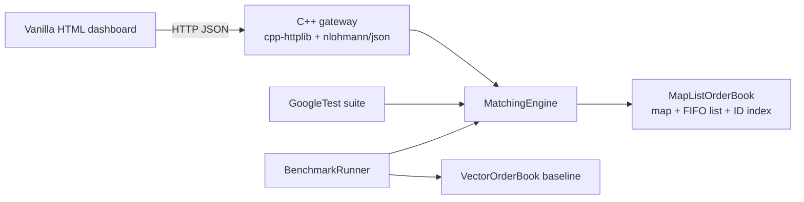

# BASALT

BASALT is a deterministic, single instrument continuous limit order book and matching engine written in C++20. It accepts limit and market orders, enforces price time priority, records executions at the resting order's price, supports partial fills and cancellation, and exposes the engine through a local HTTP dashboard.

The matching core uses fixed point integer ticks and has no HTTP or JSON dependency. A GoogleTest suite checks matching behavior and structural invariants. The synthetic benchmark compares the primary map and list book with a sorted vector baseline across seven reproducible workloads.

## Architecture



### Core model

- `basalt_core` is a C++20 static library with no external runtime dependency.
- Prices use `int64_t` ticks; `10000` ticks represent `$100.00`. Quantities are whole units stored as `uint64_t`.
- Bids use a descending `std::map`, asks use an ascending `std::map`, and every price level holds a FIFO `std::list<Order>`.
- An `std::unordered_map<OrderId, OrderLocation>` points directly to each resting order's list iterator. Cancellation is average O(1) for the lookup and erase, plus O(log P) only when the last order removes its price level.
- Matching is single threaded and deterministic. The HTTP adapter guards live engine calls with one mutex.
- Event timestamps are logical nanoseconds derived from the monotonic event sequence. This preserves replay equality while keeping timestamps increasing from zero after reset.
- Trades execute at the resting order's limit. Limit remainders rest; market remainders expire immediately and never enter the book.
- The benchmark pre-generates workload commands and latency buffers before timing. It checks that both implementations produce the same trade count and final book snapshot.

## Requirements and dependencies

- Windows x64 with Visual Studio 2022 or later, or Clang 15+ / GCC 12+.
- CMake 3.20+ and Ninja, or a Visual Studio CMake generator.
- Internet access on the first configure so CMake FetchContent can download pinned dependencies: GoogleTest 1.14.0, cpp-httplib 0.15.3, and nlohmann/json 3.11.3.
- The browser UI is static HTML, CSS, and JavaScript. It does not need Node.js or a frontend build step.

## Build and verify on Windows

From PowerShell in the repository root:

```powershell
cmake -S . -B build -G Ninja -DCMAKE_BUILD_TYPE=Release
cmake --build build --parallel
ctest --test-dir build -C Release --output-on-failure
```

If Ninja is unavailable, generate Visual Studio 2022 projects instead:

```powershell
cmake -S . -B build -G "Visual Studio 17 2022" -A x64
cmake --build build --config Release --parallel
ctest --test-dir build -C Release --output-on-failure
```

The first configure downloads the dependencies into the ignored `build/_deps` directory. On Windows, `basalt_server` links `Ws2_32` for cpp-httplib.

The repository includes VS Code CMake settings, build/test/benchmark/server tasks, and launch configurations under `.vscode/`.

For the Visual Studio generator above, executables are under `build/Release/` rather than the Ninja paths shown next.

## Run the applications

Start the local server:

```powershell
.\build\basalt_server.exe --port 8080
```

Open [http://127.0.0.1:8080](http://127.0.0.1:8080). The server seeds a five level bid and ask ladder at startup. Use **Reset empty** to clear it or **Seed demo book** to restore it.

Run the benchmark suite:

```powershell
.\build\basalt_bench.exe --orders 50000
.\build\basalt_bench.exe --orders 100000 --profile CANCEL_HEAVY
.\build\basalt_bench.exe --orders 50000 --no-baseline
```

Supported profile IDs are `BALANCED`, `BUY_HEAVY`, `SELL_HEAVY`, `AGGRESSIVE_MATCHING`, `CANCEL_HEAVY`, `CONCENTRATED_LEVELS`, and `WIDE_DISTRIBUTION`. The CLI default is 50,000 operations per profile; valid sizes range from 1 through 5,000,000.

### Recorded Release run

One local Windows x64 Release run with Clang 22.1.8 processed 100,000 commands per profile. The timed paths use the same pre-generated commands directly against each book's matching and cancellation methods, excluding HTTP, random generation, output formatting, and engine history bookkeeping. Throughput is operations per second; p99 is nanoseconds. The vector baseline comes closest in the aggressive, shallow-book profile, while the primary book leads in the deep and cancellation-heavy profiles.

| Profile | Map/list ops/s | Map/list p99 ns | Vector ops/s | Vector p99 ns |
| --- | ---: | ---: | ---: | ---: |
| Balanced | 4,778,539 | 600 | 495,717 | 7,000 |
| Buy heavy | 4,123,099 | 600 | 49,088 | 64,700 |
| Sell heavy | 5,198,478 | 400 | 51,484 | 63,800 |
| Aggressive matching | 4,868,881 | 500 | 1,545,514 | 1,700 |
| Cancel heavy | 5,443,214 | 400 | 511,059 | 4,500 |
| Concentrated levels | 5,652,368 | 500 | 703,106 | 3,900 |
| Wide distribution | 4,320,289 | 600 | 176,285 | 21,100 |

These are measurements from one machine and one run, not portable performance guarantees. Re-run the benchmark on the target machine before drawing conclusions about absolute latency.

## HTTP API

All API responses use JSON. CORS is enabled for local browser integration.

| Method and path | Purpose |
| --- | --- |
| `GET /api/state?depth=20` | Book depth, market statistics, up to 50 recent trades and activity records |
| `POST /api/orders` | Submit a `BUY` or `SELL` `LIMIT` or `MARKET` order; omit `id` or use `0` for automatic assignment |
| `DELETE /api/orders/{id}` | Cancel an active resting order |
| `POST /api/sim/step` | Generate 1–500 synthetic orders; body example: `{"count":10}` |
| `POST /api/reset` | Clear the engine; pass `{"seed_demo":true}` to reset and seed the demo ladder |
| `POST /api/benchmark` | Run one workload or all profiles; accepts `profile`, `order_count`, and `compare_baseline` |

Example order request:

```json
{"id":0,"side":"BUY","type":"LIMIT","price":10050,"quantity":100}
```

Price fields are integer ticks, not floating point dollars.

## Eight step live interview demonstration

1. **Start with a live book.** Launch `basalt_server` and show the seeded five level bid and ask ladder, best prices, spread, and active order count.
2. **Explain fixed point pricing.** Enter `10000` ticks and show the paired `$100.00` helper. Explain that integer keys avoid floating point rounding in price comparisons.
3. **Add passive liquidity.** Submit a buy limit below the best ask and a sell limit above the best bid. Point out the book remains uncrossed and the levels aggregate quantity.
4. **Show FIFO priority.** Add multiple orders at the same price and inspect their sequence numbers in the resting queue.
5. **Sweep the queue.** Submit an aggressive limit order across the displayed price. Show each execution at the resting price and the passive queue filling in order.
6. **Demonstrate a partial fill and cancel.** Use an order larger than displayed liquidity, inspect its resting remainder, then cancel a selected ID from the active orders table.
7. **Show market IOC behavior.** Reset to a thin book, send a market order larger than opposing liquidity, and show the filled quantity and expired remainder without a market order resting.
8. **Close with replay and measurement.** Run auto simulation or a benchmark profile, compare map/list and vector results, then explain the latency percentiles and tradeoff visible in the selected workload.

## Engineering Q&A

### Why use integer price ticks?

The engine needs exact equality and ordering for price level keys. Binary floating point cannot represent decimal fractions such as `$0.01` exactly. Integer ticks give exact comparisons and avoid rounding drift. Formatting into dollars is handled at the UI boundary.

### Why `std::map` + `std::list` + `std::unordered_map`?

The maps keep the best price at `.begin()` and provide O(log P) insertion/removal of price levels. Each list keeps price time priority and erases any selected order in O(1) once its iterator is known. The ID index provides average O(1) lookup of that iterator. The tradeoff is allocation and pointer chasing compared with contiguous storage.

### How does price time priority work?

The engine always matches the best opposing price first. At a price level, it consumes the front order before the next order. The engine stops when the next price no longer crosses an incoming limit. Every fill uses the maker's resting price.

### What happens during a partial fill?

Both remaining quantities and the resting level's cached volume decrease by the fill size. A partially filled passive order stays at the head of its FIFO queue. An incoming limit remainder rests on its own side at its limit price; a market remainder expires.

### What does the benchmark compare?

It runs the same pre-generated commands through the primary map/list book and a sorted vector baseline. Vector storage can win with small, shallow books because of locality. Map/list storage avoids shifting deep vectors on cancellation. Which one wins depends on workload shape and active book depth; use the recorded run rather than assuming one structure is universally faster.

### Why is the matching engine single threaded?

Matching one instrument is inherently ordered: every command must observe the state produced by all earlier commands to preserve price time priority. The core stays single threaded and deterministic. The server serializes live engine access at its adapter boundary; multiple instruments could later run as independent shards.

## Repository map

```text
include/basalt/core/       Domain types, order books, matching engine
include/basalt/bench/      Workload and benchmark interfaces
include/basalt/server/     HTTP gateway interface
src/core/                 Engine implementations
src/bench/                Workloads, profiler, CLI
src/server/               HTTP routes and executable entry point
tests/                    18 GoogleTest scenarios
web/index.html            Static trading dashboard
documents.md              Full architecture specification
PROGRESS.md               Phase completion and verification log
```

## Verification record

The implementation is built with strict project compiler flags (`-Wall -Wextra -Wpedantic -Werror` or `/W4 /WX`). The final Release build and benchmark measurements are recorded in `PROGRESS.md`.
