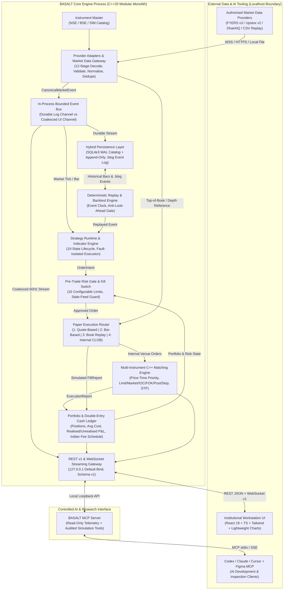

# Seed: Target Architecture & Process Boundaries (→ ARCHITECTURE.md)

> **SEED FILE** — generated by Gemini, imported by hand. Treat as a starting input, not final truth.
> Repo wins on any conflict (names/namespaces may be `atlas` or `basalt`). Expand into the final spec file; don't just copy.

To satisfy Principle 2.6 (*No unjustified infrastructure*), BASALT rejects premature microservices, Kafka, Kubernetes, and external databases in favor of a **Single-Host Modular Monolith** with cleanly isolated in-process bounded queues and an optional Python research/MCP sidecar:

